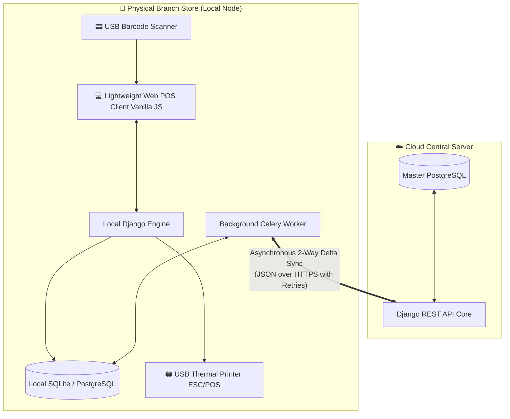

# Distributed Offline-First Retail POS Architecture

[](https://www.python.org/)
[](https://www.djangoproject.com/)
[](https://www.django-rest-framework.org/)
[](https://www.postgresql.org/)
[](https://docs.celeryq.dev/)

> **Architectural showcase extracted from a production-grade retail Point of Sale (POS) system deployed across distributed physical branch stores.**

---

## 📌 Executive Overview / Resumen Ejecutivo

In high-volume physical retail environments, **network downtime cannot halt checkout operations**. If the cloud server goes down or the store's internet fails, cashiers must continue processing sales, scanning barcodes, adjusting stock, and printing legal thermal tickets without disruption.

This repository demonstrates the core engineering patterns developed for **Trinity Sales Network**: a distributed **Offline-First Point of Sale (POS) and inventory platform** designed for 100% operational continuity.



---

## 🏗️ Key Engineering Highlights & Patterns

### 1. Offline-First 2-Way Data Synchronization (`sync/tasks.py`)
* **Atomic Transactions (ACID):** Uses Django's `transaction.atomic()` during delta downloads. If a network drop occurs mid-sync, all partial entities roll back cleanly to avoid state corruption.
* **Tombstone Deletion Pattern:** Deletions on local nodes don't simply drop records; they record a tombstone entry (`TombstoneDeletion`) with UUIDs so deletions safely propagate to the central cloud upon reconnection.
* **UUID-based Global Identity:** Primary keys for synchronization use `uuid.uuid4()` instead of sequential auto-incrementing integers, avoiding ID collisions across stores.

### 2. High-Concurrency Stock & Race Condition Prevention (`sales/views.py`)
* **Pessimistic Locking (`select_for_update`):** In stores with multiple simultaneous cashiers selling the same fast-moving item, database-level row locking prevents race conditions and overselling.
* **Dynamic Multi-Store Inventory:** Inventories are tracked per physical branch (`StockPorLocal`). Validation runs immediately prior to line-item persistence.
* **Strict Validation & Early Exit:** Out-of-stock items abort the checkout transaction before writing partial sales lines to disk.

### 3. Low-Level Hardware Integration (`hardware/escpos_printer.py`)
* **Direct ESC/POS Byte Protocol:** Communicates directly with 58mm/80mm thermal receipt printers by constructing raw byte streams (`\x1b\x40` initialization, `\x1d\x56\x00` auto-paper cut) without proprietary UI print dialogs.
* **WMI USB Plug-and-Play Detection:** Probes the Windows Management Instrumentation (WMI) subsystem (`Win32_PnPEntity`) using regular expressions against Vendor ID & Product ID (`VID_#### & PID_####`) to auto-detect active USB printers.
* **Dynamic Table Formatting:** Formats product names, quantities, and aligned monetary totals using CP437 byte encoding.

---

## 📂 Repository Structure

```
retail-pos-offline-first/
├── core/
│   ├── __init__.py
│   └── models.py            # SyncableModel base class, UUIDs, Products, and Store Stocks
├── sales/
│   ├── __init__.py
│   └── views.py             # Transactional checkout endpoint with pessimistic stock locking
├── sync/
│   ├── __init__.py
│   └── tasks.py             # Celery background workers for resilient 2-way sync
├── hardware/
│   ├── __init__.py
│   └── escpos_printer.py    # Raw ESC/POS byte protocol and Windows WMI USB driver
└── push_to_github.bat       # 1-click deployment script to personal GitHub profile
```

---

## 👨‍💻 Author

**Felipe Octavio Poblete Velásquez**  
*Full-Stack & Backend Software Engineer | Python • Django • SQL • Distributed Architectures*  

* 📍 Santiago, Chile  
* 💼 [LinkedIn Profile](https://linkedin.com/in/felipe-poblete-velasquez-4933768b)  
* 💻 [GitHub Profile](https://github.com/Leonehertz)  
* ✉️ [Felipe.poblete777@gmail.com](mailto:Felipe.poblete777@gmail.com)
